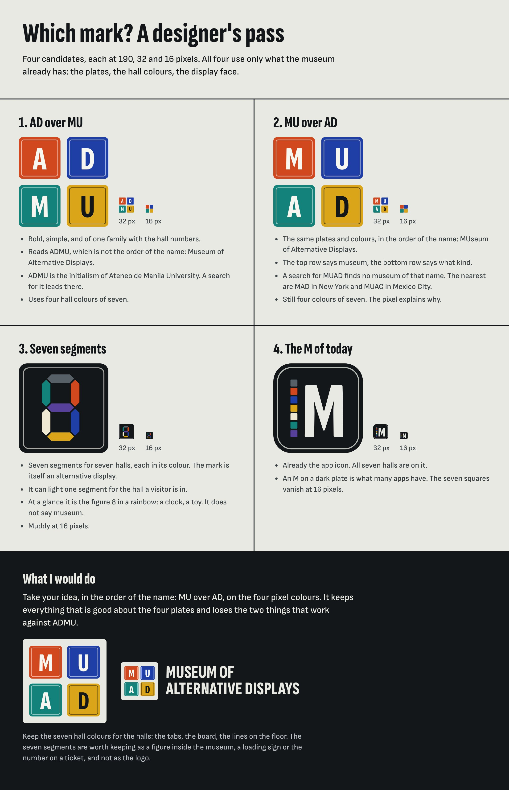

# A mark for the museum: a study

Asked on 22 November 2026: a made-up logo in the museum's own style, four letters on four squares
(AD on one row, MU on the next), each letter on a hall colour. One board argues for that idea as
strongly as it can be argued. A second sets it beside three other marks and gives a verdict.

Mark 2, MU over AD, was chosen the same day and is on the site. What was done is at the end.

## The idea, at its strongest

Four enamel plates, of one family with the hall numbers, in red lead, cobalt, turquoise and chrome
yellow. Together they read as one pixel of the museum with four sub-pixels. The letters are set in
the display face. Under 28 pixels the letters are dropped and the four colours stay, so the mark
holds as a favicon. It works at night and in one ink.

## The verdict

Keep the plates and the colours, and put the rows in the order of the name: **MU over AD**.

| Mark | For | Against |
| --- | --- | --- |
| 1. AD over MU | Bold, simple, of one family with the hall numbers | Reads ADMU, which is not the order of the name, and ADMU is the initialism of Ateneo de Manila University [1] |
| 2. MU over AD | The same plates in the order of the name: the top row says museum, the bottom row says what kind | Four hall colours of seven. A search for MUAD found no museum of that name; the nearest are MAD in New York [2] and MUAC in Mexico City [3] |
| 3. Seven segments | Seven segments for seven halls, and the mark is itself a display. It can light one segment for the hall a visitor is in | At a glance it is a figure 8 in a rainbow. Muddy at 16 pixels |
| 4. The M of today | Already the app icon, with all seven halls on it | An M on a dark plate is what many apps have. The seven squares vanish at 16 pixels |

The seven colours stay with the halls. The seven-segment figure is better kept as something inside
the museum (a hall indicator, a loading figure) than as the logo.

## Carried out

`src/mark.ts` is the one drawing, with the letters as outlines so that no file needs the typeface.

- The header shows the mark beside the name, at 40 pixels on a desk and 36 or 32 on a phone.
- The app icon runs the four enamels to the edges, parted by a black line as the sub-pixels of a screen
  are. A phone cuts the corners itself, so the plates carry no line of their own there.
- The picture shared with a link carries a white enamel plate with the mark and the name.
- `npx tsx scripts/icons.ts` writes all of these files from the drawing.

One thing differs from the first board. It said that under 28 pixels the letters go and the four colours
stay. Four bare squares in red, blue, green and yellow are the mark of Microsoft, and ours without its
letters sits close to that. So the mark is never shown without its letters. Where they cannot be read, in
the tab of a browser, the mark is its first plate alone: the M on red lead, which is what the tab showed
before.

## Making the boards again

`marks.py` holds the marks as SVG. `board.py` writes the two boards as HTML; photograph them at
1080 pixels wide and twice the size.

    python3 docs/brand/board.py /tmp

## Sources

1. OneLook, "ADMU", quoting Wiktionary: https://www.onelook.com/?w=ADMU
2. Britannica, "Museum of Arts & Design (MAD)": https://www.britannica.com/topic/Museum-of-Arts-and-Design
3. Ocula, "Museo Universitario Arte Contemporáneo (MUAC)": https://ocula.com/institutions/university-museum-of-contemporary-art-mexico/
