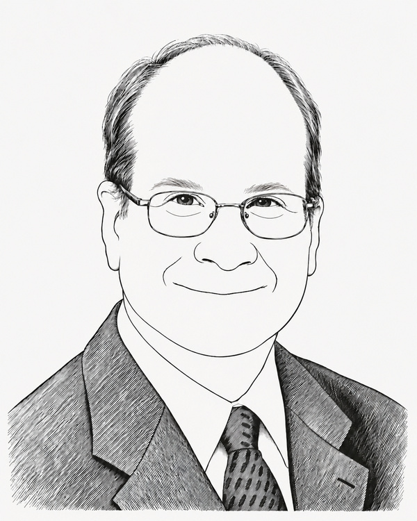

# Portraits, v4 review bundle

Imported on 22 November 2026. This folder contains the one new v4 drawing and the context needed to review that pass. It does not contain the earlier image packages or their research archive.

## Status

Louis Brus has a new drawing after the independently captioned 2008 AIP photograph reproduced by Rice University. Its pose, clothing and expression follow that photograph. The source's claimed free-use grant remains unverified, so this is a review asset, outside `public/people/` and the live portrait lookup.

- [600 × 750 JPEG](louis-brus.jpg), for review.
- [1122 × 1402 PNG master](louis-brus-master.png), the selected original output.
- [Source links, credits, measurements, review and hashes](louis-brus.json).
- [Exact generation and correction prompts](prompts.json), using the built-in image tool.
- [Drawing specification](STYLE.md).
- [Findings for all 72 reviewed people](reviewed-people.md), with [structured records and search counts](reviewed-people.json).

The source photographs, newspaper pages, books, rejected images, discarded drawing attempts and face-measurement model are omitted. Their existence or inclusion in an earlier research package does not grant publication rights. The source URLs and input hashes retain the provenance without copying those files into this repository.

## The audit is an older snapshot

V4 reviewed the supplied 72-name brief against a baseline of 38 existing approvals. It added no publication clearances under that brief's source-rights rule. That is a historical result, not the current site's count.

At import, commit `a4c8ade1fe7504fca5a7388310098add0afab3c9` has **74 portraits on the site and 36 pending**, including studies accepted under the repository's current rules. This bundle does not replace that lookup, remove those images, or overwrite the current [portrait rules](../../../PORTRAITS.md) and [to-do list](../../../PORTRAITS-TODO.md). Each structured audit record includes the site's status at import separately from the v4 decision.

The new Brus drawing does not replace the existing Brus study. Jepsen 2.3 and all live assets are untouched.

## Why the original ZIP was 525 MB

It was a cumulative research archive. Its largest components, before ZIP overhead and compression, were:

| Material | Size, decimal MB |
| --- | ---: |
| Earlier reference photos, source pages and PDFs | 291.55 |
| 49 earlier drawing masters | 105.04 |
| 38 previously approved masters | 87.11 |

Those three groups alone account for about 484 MB. None is needed to store this pass's single new drawing and concise review context. This folder is approximately 2.9 MB, including the PNG master. Per-file byte counts and hashes are recorded in `SHA256SUMS.txt` and `louis-brus.json`.

No new portrait is added to the live museum by this commit.
